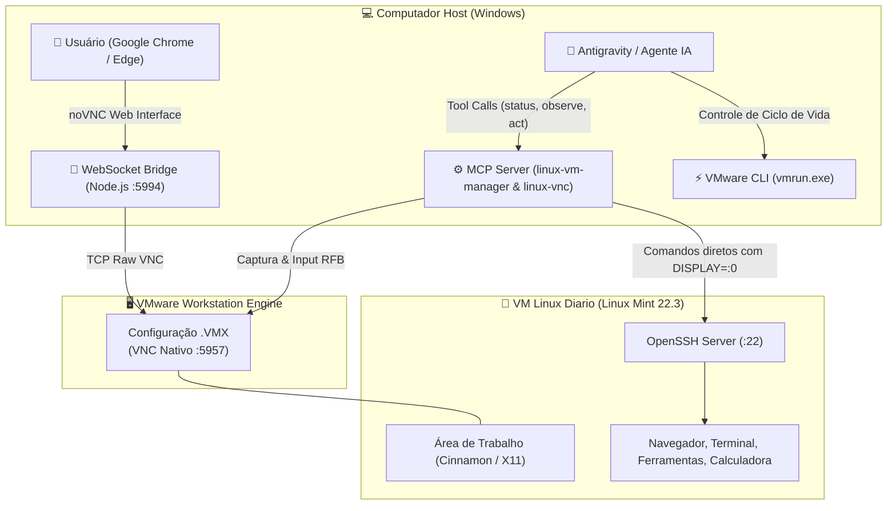

# 🖥️ Linux AI Computer Use VM

> **Ambiente Virtual Isolado para Agentes de IA com Controle Visual (*Computer Use*), Execução Híbrida (VNC + SSH) e Acompanhamento ao Vivo pelo Navegador do PC.**

[](LICENSE)
[]()
[]()
[]()

---

## 💡 A Ideia & O Conceito

Quando colocamos agentes autônomos de IA para operar um computador, surgem dois grandes desafios:
1. **Segurança e Isolamento:** Deixar uma IA com permissão de clique, download e comandos no sistema operacional principal do seu dia a dia é arriscado.
2. **Caixa-Preta (Falta de Visibilidade):** Rodar containers headless ou VMs cegas impede que você veja o que a IA está clicando e fazendo em tempo real.

### 🌟 A Solução Criada
Uma máquina virtual Linux (**Linux Mint Cinnamon**) perfeitamente orquestrada onde:
* **A IA tem "olhos e mãos":** O agente enxerga a tela gráfica com alta precisão (sub-segundo) e realiza cliques, atalhos e digitação via VNC de baixíssima latência.
* **Execução Híbrida Inteligente:** A IA pode mesclar comandos de shell via SSH (já amarrados à tela com `DISPLAY=:0`) com cliques visuais para obter máxima velocidade.
* **Live View no Navegador do PC:** Você não precisa abrir janelas pesadas do VMware. Uma aba normal no seu Google Chrome ou Edge (`http://127.0.0.1:5994`) exibe a tela inteira da VM a 60 FPS com controles táteis via **noVNC + WebSocket bridge**.
* **Zero Carga na VM:** O servidor VNC não roda dentro do Linux (dispensando x11vnc ou dependências pesadas); ele roda diretamente no **Hypervisor do VMware Workstation**, sendo à prova de travamentos do sistema operacional convidado.

---

## 🏛️ Arquitetura da Solução



---

## ⚙️ Especificações Recomendadas da VM

| Recurso | Configuração Recomendada |
| :--- | :--- |
| **Sistema Operacional** | Linux Mint 22.3 Cinnamon (64-bit) |
| **Memória RAM** | 4096 MB (4 GB) |
| **Processadores (vCPUs)** | 4 Cores (2 sockets x 2 cores) |
| **Disco Virtual** | 30 GB a 50 GB (SCSI ou SATA) |
| **Rede** | Modo NAT (compartilha a internet do host com IP fixo interno) |
| **Aceleração 3D** | Habilitada (`mks.enable3d = "TRUE"`) |

---

## 🚀 Guia Passo a Passo de Instalação (Do Zero)

### Passo 1: Baixar a ISO Oficial do Linux Mint
Você pode baixar a ISO manualmente no site do Linux Mint ou rodar nosso script PowerShell automatizado:
```powershell
powershell -ExecutionPolicy Bypass -File .\scripts\download_linux_mint.ps1
```

### Passo 2: Criar a VM no VMware Workstation
1. Abra o **VMware Workstation Pro** (ou Player).
2. Crie uma nova máquina virtual selecionando a ISO baixada.
3. Defina o nome da máquina como `Linux Diario`.
4. Aloque **4 GB de RAM** e **4 núcleos de CPU**.
5. Durante a instalação do Linux Mint:
   * Marque a opção **"Iniciar sessão automaticamente"** (*Auto-login*) para o seu usuário (ex: `kethy`). Dessa forma, a VM sempre ligará pronta para a IA interagir, sem travar na tela de senha.

### Passo 3: O "Pulo do Gato" — Ativar o VNC no Hypervisor
Com a VM desligada, abra o arquivo `.vmx` da máquina virtual com um editor de texto (ou use nosso script `configurar_vmx.ps1`):
```powershell
powershell -ExecutionPolicy Bypass -File .\scripts\configurar_vmx.ps1 -VmxPath "C:\Caminho\Para\Linux Diario.vmx"
```

O script injeta as seguintes linhas mágicas no final do `.vmx`:
```ini
# ==============================================================================
# VNC NATIVO NO HYPERVISOR (Zero overhead na VM)
# ==============================================================================
RemoteDisplay.vnc.enabled = "TRUE"
RemoteDisplay.vnc.port = "5957"
RemoteDisplay.vnc.ip = "127.0.0.1"
RemoteDisplay.vnc.keyMap = "us"
```
> [!NOTE]
> O IP `127.0.0.1` garante segurança máxima: apenas o seu próprio PC consegue acessar a porta do VNC, impedindo conexões externas pela rede local.

---

### Passo 4: Configurar a VM Convidada (Guest)
Inicie a VM e instale os pacotes básicos de automação no terminal do Linux:
```bash
sudo apt update && sudo apt install -y openssh-server wmctrl xdotool curl git net-tools
```

Adicione sua chave pública SSH do host Windows (`id_rsa.pub` ou `id_ed25519.pub`) no arquivo `~/.ssh/authorized_keys` da VM para permitir que a IA envie comandos instantâneos via SSH sem pedir senha.

---

### Passo 5: Configurar o Visualizador no Navegador (noVNC + Bridge)
1. Instale as dependências da ponte:
   ```bash
   cd viewer
   npm install
   ```
2. Baixe o cliente noVNC com o script automatizado:
   ```powershell
   powershell -ExecutionPolicy Bypass -File .\scripts\setup_novnc.ps1
   ```
3. Inicie o visualizador:
   ```powershell
   powershell -ExecutionPolicy Bypass -File .\scripts\iniciar_viewer.ps1
   ```
4. Pronto! O seu navegador abrirá em:
   ```
   http://127.0.0.1:5994/vnc.html?autoconnect=1&resize=scale&path=websockify
   ```
   Você verá a tela completa do Linux Mint com resolução dinâmica, fluida e com suporte a mouse/teclado.

---

### Passo 6: Conectar a IA via MCP (Model Context Protocol)
Copie o snippet do arquivo [`config/mcp_config_snippet.json`](config/mcp_config_snippet.json) para o seu arquivo de configuração do Antigravity (`~/.gemini/config/mcp_config.json`) ou Claude Desktop:

```json
{
  "mcpServers": {
    "linux-vm-manager": {
      "command": "node",
      "args": ["C:/caminho/para/linux-ai-computer-use-vm/mcp-server/server.mjs"],
      "env": {
        "VMX_PATH": "C:/Users/SeuUsuario/Documents/Virtual Machines/Linux Diario/Linux Diario.vmx",
        "VMRUN_PATH": "C:/Program Files (x86)/VMware/VMware Workstation/vmrun.exe",
        "VNC_PORT": "5957",
        "VIEWER_PORT": "5994"
      }
    },
    "linux-vnc": {
      "command": "node",
      "args": ["C:/caminho/para/node_modules/@hrrrsn/mcp-vnc/dist/index.js"],
      "env": {
        "VNC_HOST": "127.0.0.1",
        "VNC_PORT": "5957"
      }
    }
  }
}
```

---

## 🛠️ Ferramentas Disponíveis para o Agente

| Ferramenta | Descrição |
| :--- | :--- |
| `linux_status` | Checa se a VM está ligada, se o VNC responde e se o visualizador web está ativo. |
| `linux_prepare_if_off` | Inicia a VM em modo headless (`nogui`) pelo VMware caso esteja desligada. |
| `linux_observe` | Captura a tela atual da VM e devolve a imagem em alta definição para inspeção da IA. |
| `linux_command` | Executa comandos no shell com `DISPLAY=:0` (ex: abrir programas, scripts de teste, `wmctrl`). |
| `linux_viewer_open` | Sobe a ponte web e abre a aba do navegador no PC host para o usuário acompanhar. |
| `vnc_click` | Clica em qualquer coordenada $(X, Y)$ da tela com precisão de pixel. |
| `vnc_type_text` | Digita textos e teclas no ambiente gráfico. |
| `vnc_key_press` | Aciona combinações de teclas como `Alt+F4`, `Ctrl+C`, `Escape` ou atalhos do sistema. |

---

## 📂 Estrutura de Arquivos

```
linux-ai-computer-use-vm/
├── README.md                      # Documentação completa e guia de instalação
├── LICENSE                        # Licença MIT
├── .gitignore                     # Ignora binários pesados de VM e dependências
├── config/
│   ├── Linux_Diario_Template.vmx  # Template VMX limpo com VNC embutido
│   ├── mcp_config_snippet.json    # Configuração dos servidores MCP para Antigravity/Claude
│   └── skill_antigravity_linux.md # Skill oficial para agentes Antigravity
├── mcp-server/
│   ├── package.json               # Dependências do servidor MCP
│   └── server.mjs                 # Servidor MCP linux-vm-manager
├── viewer/
│   ├── package.json               # Dependências da ponte WebSocket
│   └── bridge-linux.mjs           # Servidor Node.js WebSocket/HTTP (Websockify)
└── scripts/
    ├── download_linux_mint.ps1    # Download automático da ISO oficial
    ├── configurar_vmx.ps1         # Injeção automática de VNC em arquivos .vmx
    ├── setup_novnc.ps1            # Download e extração do cliente noVNC
    └── iniciar_viewer.ps1         # Inicialização em 1 clique da visualização no browser
```

---

## 🎯 Exemplos de Prompts para Testar

* *"Na VM Linux Diario, abra a Calculadora e confirme pela tela que ela abriu."*
* *"Abra o Firefox na VM Linux, acesse a documentação do Node.js e me mostre o screenshot."*
* *"Abra o visualizador no meu navegador para eu acompanhar o que você está fazendo na VM."*
* *"Clone o repositório X dentro da VM Linux, execute os testes unitários e liste os resultados."*

---

## 🛡️ Licença

Distribuído sob a licença **MIT**. Veja o arquivo [`LICENSE`](LICENSE) para mais detalhes.

Feito com 💡 e automação de alta performance por **[Kethely](https://github.com/kethysb)** com suporte do **Antigravity AI**.
